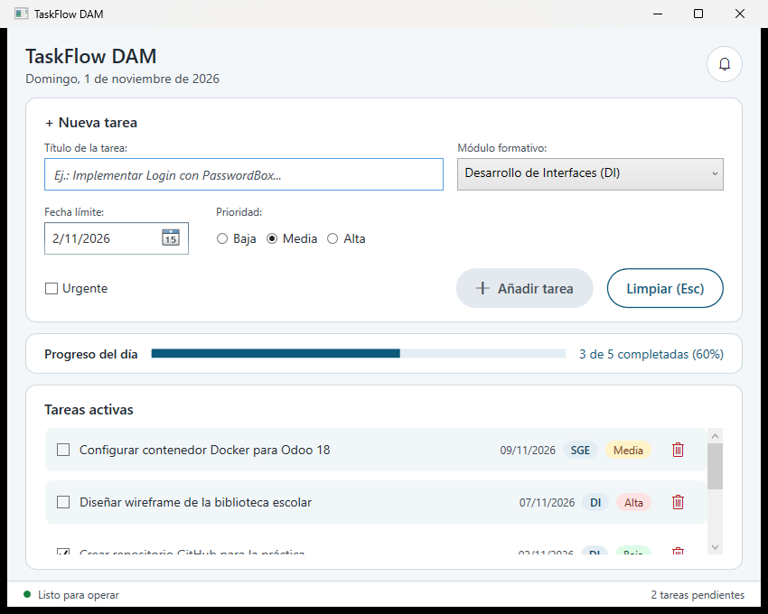
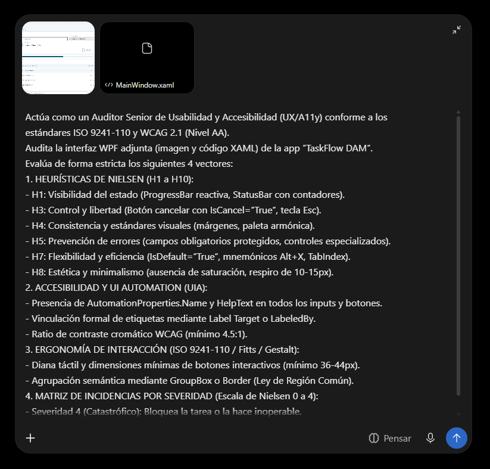

# TaskFlow DAM – Práctica 01 UD03

Abdelbarie El Harrak – 2º DAM – Desarrollo de Interfaces

## 1. Arquitectura

- **Models/Tarea.cs**: clase `Tarea` con las propiedades `Titulo`, `Modulo`, `FechaLimite`, `Prioridad`, `EsUrgente` y `Completada`. Implementa `INotifyPropertyChanged` para que la interfaz se actualice al marcar o desmarcar una tarea.
- **Models/Prioridad.cs**: valores de prioridad (Baja, Media, Alta).
- **MainWindow.xaml.cs**: es el `DataContext` de la ventana (`DataContext = this`). Tiene:
  - `ObservableCollection<Tarea> Tareas` con 5 tareas de prueba.
  - Las propiedades del formulario (`NuevoTitulo`, `NuevoModulo`, `NuevaFechaLimite`, `NuevaPrioridad`, `NuevoEsUrgente`).
  - Las propiedades calculadas `ProgresoPorcentaje`, `TextoProgreso`, `TareasPendientesCount` y `EstadoApp`.
- **Converters/PrioridadToBoolConverter.cs**: para enlazar los RadioButton de prioridad.
- **Data/TaskFlowDbContext.cs**: guarda las tareas en SQLite con Entity Framework Core.

### Data Binding

- Los controles del formulario están enlazados con `{Binding}` en modo `TwoWay`.
- La lista es un `ListBox` con `ItemsSource="{Binding Tareas}"` y un `DataTemplate` (CheckBox, título, badges de módulo y prioridad y botón de eliminar).
- Me suscribo a `CollectionChanged` de la colección y a `PropertyChanged` de cada tarea. Así, al añadir, eliminar o marcar una tarea, la barra de progreso y los contadores se recalculan solos.

## 2. Captura de la ventana

## 3. Usabilidad y accesibilidad

- Maquetación con `Grid` y `DockPanel`, márgenes de 10-15 px.
- Etiquetas con mnemónico (`_`) y `Target` en todos los campos (Alt+T, Alt+M, Alt+F, Alt+P, Alt+U).
- `TabIndex` en orden: Título → Módulo → Fecha → Prioridad → Urgente → Añadir → Limpiar.
- La prioridad está agrupada en un `GroupBox` y los botones tienen un mínimo de 36-44 px.
- Botón Añadir con `IsDefault="True"` (Enter) y botón Limpiar con `IsCancel="True"` (Esc).
- `AutomationProperties.Name` y `HelpText` en todos los controles.
- Contraste de los textos por encima de 7:1.
- El botón Añadir está deshabilitado si el título está vacío.

## 4. Auditoría con IA (Pre-Test)

He pasado a la IA la captura de la ventana y el `MainWindow.xaml` con el prompt maestro del enunciado.

**Captura del prompt:**

**Informe de la IA:**

[Informe completo de la IA](docs/INFORME_IA.md)

Resultado del Pre-Test: ninguna incidencia de severidad 4, una de severidad 3 y el resto de severidad 2. Dictamen: "Aprobación condicionada".

### Fallos detectados por la IA y correcciones

| ID | Fallo detectado por la IA | Sev. | Corrección |
|---|---|---|---|
| INC-01 | El orden de Tab (Añadir → Limpiar) no coincidía con el orden visual (Limpiar estaba a la izquierda) | 2 | Mantengo el orden que pide el enunciado y he cambiado de sitio los botones: ahora Añadir está a la izquierda y Limpiar a la derecha |
| INC-02 | El botón de eliminar era pequeño para hacer clic | 3 | Lo he ampliado a 40x40 px en `EstiloBotonEliminar` |
| INC-03 | Las casillas y las opciones de prioridad tenían un área de clic pequeña | 2 | `MinHeight="36"`, `Padding` y fondo `Transparent` en los estilos de `RadioButton` y `CheckBox`, así se puede pulsar en todo el control y no solo en el círculo o la casilla |
| INC-04 | La prioridad no tenía una agrupación propia | 2 | He metido los `RadioButton` en un `GroupBox` con la etiqueta "_Prioridad:" como cabecera |
| INC-05 | El lector de pantalla no avisaba al cambiar el progreso o las pendientes | 2 | `AutomationProperties.LiveSetting="Polite"` en el texto del progreso y en el contador de pendientes |
| INC-06 | No se puede deshacer una eliminación | 2 | No lo he implementado. Antes de borrar se pide confirmación con un mensaje Sí/No, que evita borrar por error |
| INC-07 | No se demuestra la validación de fechas escritas a mano | 2 | Ya estaba hecho: en `BtnAgregar_Click` se comprueba que la fecha no sea anterior a hoy y se muestra un aviso. La IA no lo vio porque solo le pasé el XAML |
| INC-08 | No se pudo comprobar el contraste sin `App.xaml` | – | Los colores están en `App.xaml`. Todos los textos superan 7:1 (texto principal 14.6:1, secundario 8.4:1, botón 7.6:1, badges más de 8:1) |
| INC-09 | No se pudo comprobar la confirmación al eliminar | – | Ya estaba hecho: `BtnEliminar_Click` muestra un `MessageBox` Sí/No antes de borrar |
| INC-10 | La lista usa `ItemsControl` en vez de `ListBox` | 2 | La he cambiado a `ListBox` y le he quitado el resaltado de selección con un `ItemContainerStyle`. Ahora el lector de pantalla anuncia "Lista de tareas" y cada fila como elemento de la lista |

### Segunda pasada (después de las correcciones)

He repetido la auditoría con el mismo prompt maestro, esta vez con Claude. Le pasé la captura nueva, `MainWindow.xaml`, `App.xaml` y `MainWindow.xaml.cs`, para que pudiera comprobar también el contraste y la validación en C#.

[Informe de la segunda pasada](docs/INFORME_IA_2.md)

En esa revisión salieron tres detalles más, que he corregido:

| Fallo detectado | Sev. | Corrección |
|---|---|---|
| El botón "Añadir tarea" deshabilitado se veía con poco contraste (estaba al 50 % de opacidad) | 1 | Le he puesto fondo gris claro y texto gris oscuro (6.8:1) en lugar de la opacidad |
| El ToolTip de la fecha decía "dd/mm/aaaa" pero el `DatePicker` muestra "2/11/2026" | 1 | He cambiado el texto a "día/mes/año" |
| El botón del calendario del `DatePicker` se anunciaba en inglés ("Show Calendar") y sin `HelpText` | 1 | Le he puesto `Name` y `HelpText` en español al cargar la ventana |

**Resultado final:** ninguna incidencia de severidad 2, 3 ni 4. Quedan 3 detalles cosméticos (severidad 1):
- El `ComboBox` tiene el estilo gris de Windows.
- El formato de la fecha es distinto en el `DatePicker` y en la lista.
- No se puede deshacer al eliminar, aunque antes se pide confirmación.

Nota del test: **9.1 / 10**, que equivale a 4.55 / 5 en el bloque de usabilidad.
